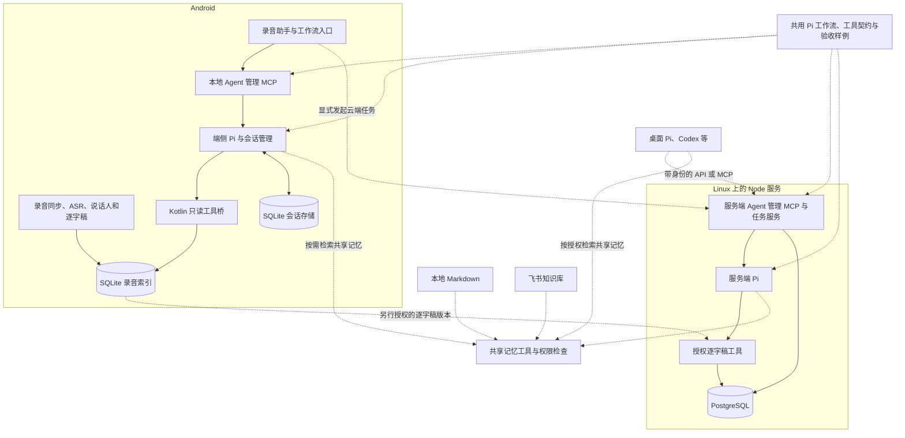
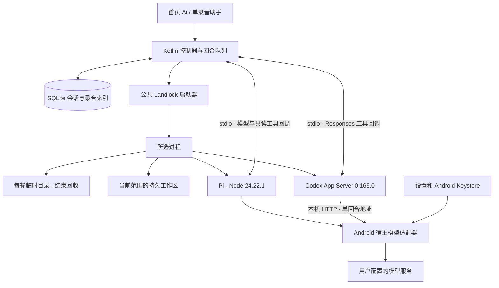
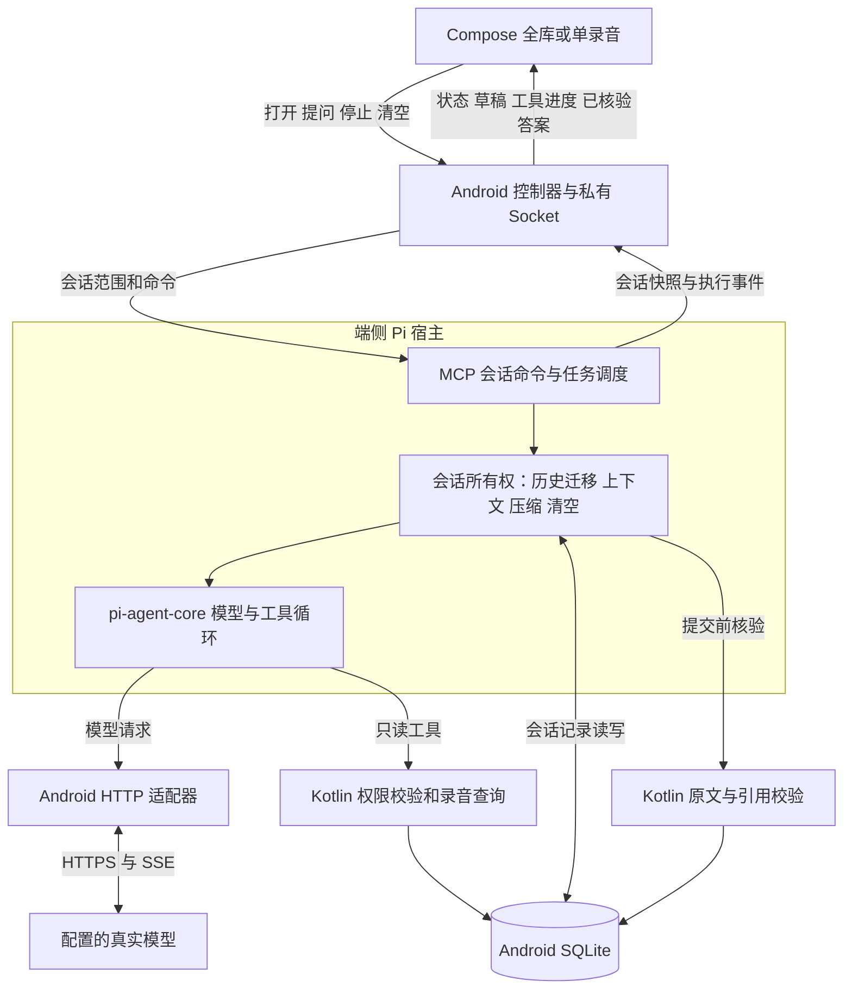
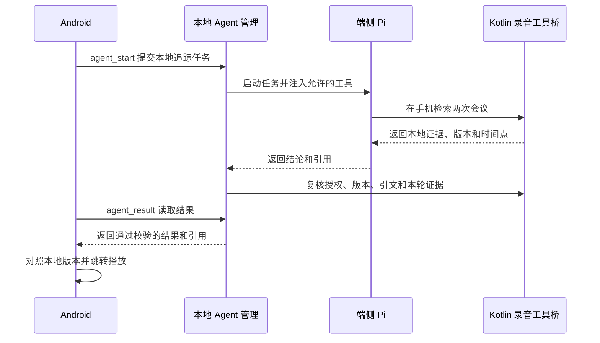

# 录音豆 Agent 与共享记忆架构

2026-11-15 · v0.6 统一 Pi / Codex 后端、共享上下文与历史迁移

Android 当前使用统一 AgentController 调度端侧 Pi 或 Codex，两个后端共享 SQLite 会话、上下文和录音工具。Linux Pi、跨端 MCP 与共享记忆是后续目标；各端接入自己的任务、权限和数据实现。Android 持有录音与逐字稿，云端保存用户选定的共享记忆及另行授权的逐字稿副本。

## 0. 术语

| 术语 | 含义 |
| --- | --- |
| 录音资产 | 设备同步或用户导入后，由 Android 保存、验证和播放的音频。 |
| 逐字稿版本 | 带片段 ID、时间范围和说话人信息的已提交文本版本。 |
| Agent 运行时 | 负责模型调用、工具循环、会话和执行事件的组件。Pi SDK 是首个建议接入项。 |
| Agent 任务 | 由录音豆发起、有执行范围和生命周期的工作，返回可验收结果。 |
| Agent 管理 MCP | 两端共用的 Agent 清单、任务提交、查询、取消和结果读取契约。 |
| 共享记忆 | 用户选中且允许跨 Agent 检索的长期偏好、术语或项目笔记。 |
| 授权逐字稿 | 用户另行允许云端检索的逐字稿版本。 |

## 1. 现状与问题

应用目前使用端侧 Pi / Codex 循环、SQLite/FTS4 以及五个只读录音工具。旧 Kotlin 循环已移除；Kotlin 保留业务契约、提示词、引用核验和权限边界。工具在手机上查询录音目录、片段、待办和重点，再把所需文字交给用户配置的模型服务。回答落盘前会核对本轮返回的证据、原文版本和引文，并支持从引用跳转到播放。

端侧 Pi 和 Codex 已在 Android 子进程中运行模型与工具循环，通过应用桥读取 SQLite。服务端 Pi 使用同样的工具契约访问云端授权数据。任务 ID 和执行位置由产品管理，跨 Agent 的长期记忆通过共享记忆 API 检索。

## 2. 产品目标与阶段范围

- **录音助手**。应用内日常问答由 Pi / Codex 二选一执行，两者共用录音工具语义、保留上下文和引用标准。
- **录后扩展**。围绕已经提交的逐字稿提供工具和固定工作流，让 Pi 生态能复用录音、重点和待办。第一项用跨会议决策变化表和待办草稿验证价值，再决定是否接入纪要、导出和后台订阅。
- **共享记忆**。用一批选定的 Obsidian 笔记跑通自动增量同步、项目隔离和多 Agent 检索。Agent 提炼的新记忆后续可走草稿确认。
- **双端执行**。先验证 Android 上的 Pi 运行时和应用桥，再将同一工作流接到 Linux。以相同的 MCP 客户端测试两端的任务生命周期。

## 3. 系统边界

Android 持有设备录音、WAV、逐字稿和本地索引。录音入库后按所选 ASR 配置转写，融合说话人和时间轴，提交版本。Agent 从已提交版本取证，生成答案或待办草稿，应用校验并保存结果。

用户分别控制三项数据权限：选定记忆同步、指定逐字稿共享、ASR 音频上传。逐字稿默认留在 Android；选中的文本在明确授权后进入云端证据库，供手机离线时继续处理。各任务同时按工作区、录音范围、数据类型和允许的工具授权。单独展示云端服务及其配置的模型处理方。

执行位置与模型位置分别配置。端侧 Pi 在手机本地规划和调用工具，使用远程 LLM 时仍会发送问题及必要的证据文本。全离线工作流需要端侧 LLM 支持工具调用。端侧任务失败保留在本机，重新在服务端运行由用户显式发起并重新授权。

## 4. 端云目标架构

虚线表示计划中的云端接入。已实现的端侧会话流程见第 6 节。



## 5. 模块改造清单

| 模块 | 当前入口与职责 | 建议改造 |
| --- | --- | --- |
| Android `app` | 已有统一后端选择、沙箱、会话、SQLite/FTS4、前台任务保护和中断恢复提示。 | 后续扩展端云任务调度。 |
| Kotlin `core` | ASR 接口；AgentContract、AgentContext、AgentPrompts、RecordingAnswer 和工具 schema。 | 保持共享契约，不再维护第三套 Agent 循环。 |
| Pi JavaScript 宿主 | 已有 tools/pi-agent，会话管理和循环通过 Android 接口接入模型、存储与录音工具。 | 延用共享契约扩展 Linux 宿主。 |
| Node 服务 | 新模块。 | 🆕 提供同契约的远端 MCP、云端任务和 Pi 宿主，以及授权录音证据查询。 |
| PostgreSQL | 云端执行方案的候选存储。 | 🆕 保存任务、授权范围及选中逐字稿的版本副本。 |
| 共享记忆连接器 | 设计提案，见 7.1 节。 | 🆕 将 Markdown 或飞书节点映射到同一套记忆条目和检索契约。 |
| Obsidian 导入器 | 现有 Git 同步提供已提交的 Markdown 版本。 | 🆕 在受信任的本机选取笔记并调用导入 API；使用现有同步节奏或独立的轻量增量任务。 |
| 桌面 Agent 接入 | 各运行时持有各自会话。 | 🆕 按授权使用远端 Agent 管理和共享记忆工具；会话与任务留在其执行位置。 |

## 6. 运行时与部署边界

| 方式 | 建议用途 | 落地依据 |
| --- | --- | --- |
| Android Termux + Pi | 可选的开发对照环境，用于定位 Pi 依赖或系统兼容问题。 | Pi 官方记录了 Termux 路径。Pi 自身 RPC 可控制进程，Agent 管理 MCP 是独立的业务接口。 [Pi Termux](https://pi.dev/docs/latest/termux) · [Pi RPC](https://pi.dev/docs/latest/rpc) |
| Android APK + 嵌入式 Node + Pi | 正式产品优先验证的候选。由应用管理的工作进程运行固定版本的 Pi，Kotlin 通过应用私有 IPC 提供只读工具和本地状态。 | Node.js 上游将 Android 列为非支持平台。移动构建须满足所选 Pi 版本的 Node 要求，并验证 ARM64、Android 版本、4 KB/16 KB 页、依赖及进程生命周期。先试 Pi SDK；若完整 SDK 的终端或原生依赖无法移植，验证 `pi-agent-core` 配合产品自有工具，逐项确认可用扩展。 [Node.js 平台支持](https://github.com/nodejs/node/blob/main/BUILDING.md#android) · [Android Bound Services](https://developer.android.com/develop/background-work/services/bound-services) |
| Linux + Pi TypeScript SDK | 云端执行同一工作流，使用云端任务状态、权限和数据适配器。 | 官方 SDK 支持会话、订阅和自定义工具，Pi 也可作为 MCP 客户端。 [Pi SDK](https://pi.dev/docs/latest/sdk) · [Pi MCP](https://pi.dev/docs/latest/mcp) |
| Android VM | 受控设备有额外隔离要求时评估。 | AVF 依赖设备支持。目标机权限、包体和功耗需实测。 [Android AVF](https://source.android.com/docs/core/virtualization) |
| Linux + Codex SDK | 需要独立代码工作区和执行环境的子任务，如从获准的需求纪要生成脚本或修改指定仓库。 | OpenAI 官方文档推荐服务端 SDK 做程序化调用。深度接入线程、审批和流式交互时可评估 App Server。 [Codex SDK](https://learn.chatgpt.com/docs/codex-sdk) · [Codex App Server](https://learn.chatgpt.com/docs/app-server) |

### 手机端助手沙箱（2026-11-15）

首页 Ai 使用 SQLite 里唯一的全库会话。录音详情按录音 ID 打开独立会话。两种入口共用一个 Android 控制器和执行队列。打开、切换或清空会话只处理 SQLite，收到提问才启动所选后端。App 同时执行一个模型回合。每个回合使用独立临时目录，完成或取消后回收进程与该目录。会话 ID、历史和录音权限由 App 持有，与进程 PID 无关。



工作区分两层，文件和会话历史各有自己的归属：

| 位置 | 用途 | 生命周期 |
| --- | --- | --- |
| `files/agent-workspaces/global/` | 首页 Ai 的持久工作区，供显式保存的文件和记录使用 | 跨回合、进程重启与后端切换保留 |
| `files/agent-workspaces/recordings/<录音 ID 摘要>/` | 单录音助手的持久工作区 | 与全库和其他单录音工作区隔离 |
| `cache/agent-*/` | 本轮 cwd、输入、中间文件、运行日志和临时运行时状态 | 结束或取消后回收 |
| SQLite | 聊天历史、会话 ID、引用 | 按 App 的会话操作管理 |

启动器仅授权当前范围的持久工作区和本轮临时目录。后端通过 `SOUND_AGENT_WORKSPACE` 定位持久目录。后端的 HOME、CODEX_HOME 和 TMPDIR 留在临时目录，避免把聊天、遥测和运行时缓存当作长期文件。当前助手尚未暴露用户管理这些文件的界面。

Pi 和 Codex 都需要 Landlock ABI 6。启动器限制任务文件的读写，按白名单开放运行时路径。两者以普通 App UID 执行，继承相同的文件规则。Pi 请求模型经 stdio 返回 Android。Codex 的 Responses 请求先到本机临时 HTTP 端口，由 Android 转发到设置里的 Base URL。Landlock 的 TCP 连接规则按端口匹配，relay 本身只监听 IPv4 回环地址。任务目录和进程环境不保存上游 API Key。日常录音问答开放只读录音工具，Codex 的通用 shell 保持关闭。

在首页 Ai 或单录音会话，输入以 `/node` 开头的问题可发起脚本回合。Pi 和 Codex 都通过同一个 `run_node` 工具调用由 Android 启动的独立 Node 进程，回合只注册这个工具。脚本通过 `process.env.SOUND_AGENT_WORKSPACE` 访问当前范围的持久文件。脚本进程有独立临时目录，Landlock 限制文件范围，Node 权限限制子进程和原生扩展，seccomp 拒绝创建网络 socket。工具返回有限的标准输出和退出状态。

「设置 → AI 助手后端」可选择 Pi 或 Codex，并为各自配置 Base URL、模型和 Key。Pi 支持 Chat Completions，地址留空时沿用现有纪要配置。Codex 要求 Responses API。v0.1.12 默认使用 Pi，旧版的「自动」和「内置助手」读取为 Pi，显式保存的 Codex 选择继续生效。运行助手需要安装包包含所选后端，并且手机支持 Landlock ABI 6。

2026-11-15 清理：显示历史 `turns` 与模型上下文 `contextMessages` 分离。后端切换只交接保留消息、摘要和最近一次 usage，不从完整显示历史恢复已压缩内容。Codex 保存工具调用/结果及原生 token usage；两端在 200k 阈值进行语义压缩，保留最近消息及所需的工具父调用。提示词统一由 Kotlin 提供。

旧 `qa` 字段以 `legacyQa` 只读兼容，随索引投影在事务内一次性迁入单录音助手，保留原始时间、回答和引用版本。一次性标记阻止清空会话后重新导入。重转写保留历史，旧引用按版本失效。`assistant_runs` 记录在途请求，与最终回答原子清除；应用重启展示中断提示，不自动重发模型请求。WorkService 同时跟踪全库和单录音助手的活动任务。

双后端验证构建需 JDK 17、NDK 28.2.13676358、Node ≥22.19、Python ≥3.11 和 zstd。使用 [Codex ARM64 0.165.0 发布包](https://github.com/openai/codex/releases/download/rust-v0.165.0/codex-aarch64-unknown-linux-musl.zst)，构建脚本会校验摘要。

```sh
./gradlew :app:assembleDebug :app:assembleDebugAndroidTest -PincludePi=true \
  -PcodexArchive=/absolute/path/to/codex-aarch64-unknown-linux-musl.zst \
  -PdebugApplicationIdSuffix=.agentpoc
```

2026-11-15 在 Magic V6（PNM-AN10、Android 17、4 KB 页）安装独立 `.agentpoc` 包，主机与设备上的 APK SHA-256 一致。四项专项测试通过。通过实际设置页切换 Pi → Codex → Pi，每轮从首页 Ai 发送问题。两组本机模拟服务收到各自配置的请求路径、模型及测试 Authorization 值，SQLite 保持同一全库会话 ID、顺序追加三轮及录音原文引用。两次切换后的请求均包含前一后端的历史。另验证取消 Codex 请求后保留聊天和持久文件，临时目录被回收。

两次启动 Node 子进程实际读写同一个全库持久文件，临时目录各自独立且退出后移除。两个进程访问另一个录音的合成文件都被 Landlock 拒绝。测试使用独立合成录音和本机接口。复测类见 [AgentBackendPhoneTest](../app/src/androidTest/java/dev/soundsoftware/app/inference/AgentBackendPhoneTest.kt)。

同日增加了真实工具链的文件交接测试。Magic V6 上，Codex 在首页 Ai 发出 `run_node` 调用，执行的脚本生成随机数并写入全库工作区。切到 Pi 后发起第二个 `/node` 回合，脚本从同一路径读取原值、计算两倍并写回。第一次回复和 Pi 的首次模型请求都不含原值。测试还校验跨工作区读、创建 TCP socket 和创建子进程失败，以及两轮临时目录回收。两个 Agent 与脚本进程在手机上运行，模型回复通过本机模拟接口提供。

同日用真实 `gpt-6.1-sol` 重跑，Codex 使用 Responses，Pi 使用 Chat Completions。独立测试包从空的合成库和新会话开始。真实模型首次走了 Codex 的通用 `exec`，App 随后将内置模型目录的工具模式设为 `direct`，由 App Server 回调执行已注册的工具。复测中每个后端都从自然语言生成脚本并调用 `run_node`。Codex 写入运行时生成的原值 386784，Pi 从同一 JSON 文件读出并写回 773568。会话 ID 一致，原值未出现在 Codex 的聊天答复或工具输出中，两轮的临时目录均回收。模型访问经 USB 转发到临时网关，Agent 和 Node 在手机执行。验收用例为 `AgentBackendPhoneTest.realModelsGenerateAndShareAWorkspaceFile`。

同日用原发布证书将 Magic V6 的 `dev.soundsoftware.app.release` 从 v0.1.10 覆盖到 v0.1.11（versionCode 13）。升级前后 18 个 WAV 和 18 份元数据的 SHA-256 一致，录音数据库所有逻辑行一致，含两个全库会话、三个单录音会话和 20 条待办。原设置逐字节一致，已保存的模型密钥可读取。签名 APK 和手机安装的 APK 摘要一致。

同一真实模型用例在 v0.1.11 正式包内以隔离的合成库和设置复测通过。Codex 通过 Responses 生成并执行 Node 脚本，把运行时生成的 572599 写入持久工作区。切到 Pi 后，会话 ID 保持一致。Pi 通过 Chat Completions 生成并执行另一个脚本，从同一 JSON 文件读取该值并写回 1145198。本轮临时目录已回收。模型请求经 USB 临时转发，两个后端和脚本均在手机运行。

Magic V6 原签名覆盖 v0.1.12 后，设置页实测仅显示 Pi 和 Codex。迁移测试覆盖未配置、旧自动、旧内置助手、Pi 和 Codex 五种存量设置，保留两组模型配置。正式包合成库用同一真实模型重跑了文件交接，Codex 写入 728689，同会话切到 Pi 后从同一持久文件读出并写回 1457378。

同日清理与回归结果见 [历史残留审计及修复](validation/legacy-agent-audit-2026-11-15.md#同日修复与验收结果)。实际 Pi/Codex 交接、合成 200k 分支、后台排队/取消与旧 qa 迁移已验；真实大上下文质量及系统低内存回收仍需专项验收。
### 录音工具 stdio MCP 真机验证

录音问答默认用 stdio MCP。Pi 以 SDK 的 stdio 客户端执行 `tools/list` 和 `tools/call`。Codex 0.165.0 读取本轮 `mcp_servers.recordings` 配置，使用原生 MCP 客户端启动同一个桥接进程。桥接通过本轮授权的 IPv4 回环端口向 Android 查目录和执行工具。Android 按入口绑定 `RecordingIndex.toolsFor(recordingId)`，记录本轮证据并核对最终引用。录音数据库留在 Android 主进程的权限范围。可选查询参数的 JSON `null` 表示省略，显式时间戳 `0` 仍参与过滤。

首次真机验收使用 `.mcppoc` 调试包，构建时在前述 debug 命令中改用 `-PdebugApplicationIdSuffix=.mcppoc`。Magic V6 上运行 `AgentBackendPhoneTest.stdioMcpDiscoversFiveToolsAndRejectsAnotherRecording`（`-e agentPhone true`）。独立库包含两条原文带相同关键词的合成录音。对 Pi 和 Codex，模拟模型均发现五个工具，在录音 A 的问答页读到 A 的证据，传 B 的 ID 时收到 Android 的 `recording_scope_denied`。

真实模型复验使用同一独立包名和新建的两条合成录音。`AgentBackendPhoneTest.realModelsUseScopedStdioRecordingMcp` 在 Magic V6 上通过。Pi 经 Chat Completions、Codex 经 Responses 请求真实 `gpt-6.1-sol`，两边的 `tools/list` 均返回五项。Codex 在后续模型请求中按需带上选中的工具。两边在录音 A 的页面通过 `search_recordings` 获得经 Android 核验的 A 引用，再通过 `read_segments` 显式提交 B 的 ID。Android 返回 `recording_scope_denied` 和无证据结果。临时网关经 USB 中转模型请求，并为负向探针补充专用模型提示，使模型实际发出该调用。权限校验在手机上执行。设备正式 v0.1.12 APK 摘要与签名基线一致。

同日从 `main`（`a5b807b`）构建 v0.1.13（versionCode 15），在 Magic V6 上用原发布签名覆盖 v0.1.12。手机 APK 与签名产物的 SHA-256 一致，13 项 ASR 和说话人模型产物与上一版匹配。使用同签名辅助包在正式 APK 里创建隔离录音库和设置，以上真实模型用例在两条合成录音上通过。Pi 和 Codex 都发现五项工具、引用 A 的原文，并在显式传入 B 的 ID 时收到 Android 的 `recording_scope_denied`。

升级前后 18 个 WAV 和 18 份录音元数据的 SHA-256 一致。已有 SQLite 行一致，含 1 个全库会话、3 个单录音会话和 20 条待办。两张新增的助手状态表为空。正式设置逐字节一致，已保存的模型密钥仍可读取。验收结束后已移除辅助包并重新打开正式 App。

### Pi GUI 项目的桥接

| 项目 | 运行时与 GUI 的桥接 |
| --- | --- |
| Pi Web | Next.js 进程内创建 Pi `AgentSession`。浏览器用 HTTP 提交命令，用 SSE 订阅会话事件。历史列表可直接读取会话文件。 [Pi Web 架构](https://github.com/agegr/pi-web/blob/main/AGENTS.md#architecture) |
| PiClaw | Web 层接收运行时投影的草稿、状态和已提交消息。当前原生执行路径使用自己的事件适配层，通过 Web SSE 交付，早期直接订阅 AgentSession 的适配器已退役。 [PiClaw Web 事件](https://github.com/rcarmo/piclaw/blob/main/runtime/docs/web-sse-inventory.md) |
| Polpo | 宿主启动 `pi --mode rpc`，通过 stdin/stdout 收发 JSON，远程手机界面经 WebSocket 接收事件与发送命令。 [Pi 适配器](https://github.com/pugliatechs/polpo/blob/main/src/agent/pi-agent.js) · [WebSocket 实现](https://github.com/pugliatechs/polpo/blob/main/src/server/websocket.js) |

录音豆后续 GUI 可沿用这些项目的命令与事件分离方式。建议前端依赖提交、取消、查询和订阅的业务接口。事件使用可跨宿主的任务 ID、阶段、工具状态和答案更新，最终引用是单独的结构化字段，点击时由应用检查版本并定位音频。Android 可以在 Kotlin 中映射为 Flow，远端可以用 SSE 或 WebSocket。Agent 管理 MCP 用于互操作与调度，GUI 的可视状态由产品事件承载。

### 历史验证：Magic V6 的 Pi Service 原型（2026-11-13）

- 使用 `-PincludePi=true -PdebugApplicationIdSuffix=.pipoc` 构建独立测试 APK。Android 私有 Service 启动 `:pi` 进程，经 JNI 加载 Node 24.22.1，执行 `pi-agent-core` 1.5.2。Binder 管理服务绑定，应用私有 Unix socket 传输模型和工具回调。原型从现有问答入口进入。
- Magic V6（Android 17、4 KB 页）用两条合成录音完成问答。Pi 调用 Kotlin `search_recordings` 查询 SQLite，Kotlin 核对并保存两个原文引用，点击第二条跳到 5.3 秒。另验证模型请求进行中取消和随后重新提问。模型响应使用手机本机模拟服务。
- Android 在 Node 进程内通过 MCP 内存传输调用共用工具实现。Linux Node 24 容器用同一模块跑通 Streamable HTTP 的列表、开始、状态、结果与取消。任务注册表是内存原型，云端身份、持久化及共享记忆属于后续接入。

### 历史验证：Pi 会话迁移（2026-11-13）

首页使用唯一全库会话。录音详情以稳定录音 ID 绑定一个独立会话。单录音工具在 Kotlin 层注入绑定 ID 并拒绝其他 ID，原文校验使用同一范围。全库工具只查询录音索引。重转写或改名保留会话，原文版本不匹配时禁用旧引用。删除录音级联删除专属会话，保留全库已显示回答，清空全库模型上下文和摘要，防止已删内容通过历史回到模型。

Compose 向控制器发出打开、提问、取消和清空命令，并订阅可恢复的界面状态。Pi 宿主决定会话 ID、历史迁移、上下文拼装、压缩和清空。Android 通过同一份 SQLite 提供持久化接口，并负责录音权限与引用核验。Pi 生成完整模型请求消息，Android HTTP 适配器按现有模型配置发出请求，从 SSE 解出草稿与工具调用片段。DeepSeek 直连使用非思考模式。 [DeepSeek Thinking Mode](https://api-docs.deepseek.com/guides/thinking_mode/)



旧 SQLite 会话按全库或录音范围在首次打开时迁移。宿主保留原会话 ID、用户可见历史、可用的模型消息和压缩摘要。清空由宿主生成新 ID，并由存储适配器原子替换该范围的记录。界面快照只包含会话 ID、可见问答和用量统计，模型上下文留在宿主侧。

Magic V6 用配置的 DeepSeek Flash 和独立合成录音库通过两项真机回归。迁移后续聊能引用录音，并复述只存在于旧会话的测试暗号。清空后换用新会话 ID，发给真实模型的首个请求只有系统提示和新问题，后续请求也未出现旧暗号。单录音历史保留。另一项回归覆盖流式、工具调用、取消、引用回放和录音删除后的范围隔离。手机已有音频及元数据校验值一致。压缩以模拟用量验证，覆盖旧摘要、最近消息和清空后的空上下文。

Magic V6 用已配置的 DeepSeek `deepseek-flash` 和独立合成录音库验证增量、工具、引用回放、单录音范围、取消和删除后的全库历史。测试构建基于手机已安装的 v0.1.6 开发版，保留 Qwen NPU 与说话人配置。Linux 服务端鉴权和共享记忆仍属于后续接入。

旧 Pi Service 已由本节前述的公共 Landlock 启动器取代。

Pi 的文本工作流在固定运行环境中启动，仅注册产品工具，关闭通用 shell、文件写入和任意扩展发现。上线的扩展固定版本并审核来源。普通 Android 工作进程若与 App 共用 UID，进程隔离用于故障和生命周期管理，文件权限仍由 UID 决定。能执行任意代码的任务须使用有实际权限边界的运行环境，端云两侧均在工具调用时复核权限。 [Pi 安全指南](https://pi.dev/docs/latest/security) · [Pi 扩展](https://pi.dev/docs/latest/extensions)

## 7. 已有约束与建议选型

| 来源 | 约束或建议 |
| --- | --- |
| 已确认项目规则 | 设备同步和转写由录音业务负责，ASR 厂商差异留在 Adapter，远程上传由用户选择。 |
| 已实现的回答行为 | 引用须对应本轮取得的原文及版本；逐条核验，界面可定位到播放。 |
| 用户需求 | Pi 在 Android 端侧运行，Android 与服务端共用一套 Agent 管理 MCP，部分记忆自动同步到云端。 |
| 本稿建议 | 先验证端侧 Pi，再用同一工作流接服务端。Android 继续持有本地素材，云端只保存已授权数据。 |
| 本稿建议 | 每条记忆指定一个可编辑的权威来源。已选 Obsidian 笔记以原笔记为权威，飞书原生条目以飞书正文为权威。 |

### 7.1 可移植的共享记忆模型（调研提案，2026-11-14）

共享记忆的组织结构独立于存储选型。Markdown、飞书知识库或其他支持相同契约的存储都可以提供共享记忆。云端执行另有任务与证据存储需求。

#### 开源项目怎样组织记忆

星数取自 2026-11-14 的 GitHub 仓库数据，反映仓库整体关注度。

| 项目 | 核心结构 | 与本地 Obsidian 记忆库的差异 |
| --- | --- | --- |
| OpenClaw · Memory Wiki（主仓约 394k★） | 内置记忆有每日笔记与长期 `MEMORY.md`。Wiki 插件把来源整理为页面，记录声明、证据及状态，生成过期和冲突检查。 | 我们也有 `notes/`、稳定页面、索引及定期整理。Wiki 插件把声明与证据变为可检索数据，并能区分人工内容与生成内容。 [内置记忆](https://docs.openclaw.ai/concepts/memory) · [Wiki 插件](https://docs.openclaw.ai/plugins/memory-wiki) |
| OpenKnowledge（约 4.8k★） | Markdown 和 Git 保存知识。来源、综合条目和目录级规则支持持续整理，记录来源并建立双链。它将 Karpathy 的 LLM Wiki 模式做成可操作的产品。 | 我们已有 `AGENTS.md`、`INDEX.md` 和按领域分工的页面。它进一步将来源追踪、模板和跨页更新产品化。 [项目](https://github.com/inkeep/open-knowledge) · [工作流](https://github.com/inkeep/open-knowledge/blob/main/docs/content/workflows/karpathy-llm-wiki.mdx) · [原始 LLM Wiki 模式](https://gist.github.com/karpathy/442a6bf555914893e9891c11519de94f) |
| OpenViking（约 42k★） | 以 `viking://` 目录组织资源、记忆和技能。目录级 L0 摘要、L1 导览和按需读取的 L2 正文支持渐进检索。 | 我们的索引行、项目摘要和完整页面已有相近的阅读顺序。OpenViking 生成目录摘要并将它们接入检索。 [上下文层级](https://github.com/volcengine/OpenViking/blob/main/docs/en/concepts/03-context-layers.md) |
| Mem0（约 69k★） | 从消息提取短记忆，以用户、Agent 或运行 ID 等字段限定检索范围，按需召回。 | 我们以人能编辑的页面组织项目与工作流。Mem0 适合提取一条长期偏好或事实，用于生成候选条目。 [开源实现](https://github.com/mem0ai/mem0/blob/main/mem0/memory/main.py) · [开源 REST API](https://github.com/mem0ai/mem0/blob/main/docs/open-source/features/rest-api.mdx) |
| Graphiti（约 33k★） | 证据事件生成实体和关系，关系带生效与失效时间，可追溯至来源。 | 我们用有效决策、变更记录和归档管理历史。Graphiti 能按时间计算哪条关系曾经有效，适合跨会议追踪决策。 [项目](https://github.com/getzep/graphiti) · [关系处理实现](https://github.com/getzep/graphiti/blob/main/graphiti_core/utils/maintenance/edge_operations.py) |
| BookStack（GitHub 镜像约 19k★） | 团队用书架、书籍、章节和页面组织内容，角色和内容权限控制访问。 | 我们的领域、项目和章节可映射到类似导航。企业协作还需要显式控制谁可以读取和编辑。 [内容结构](https://www.bookstackapp.com/docs/user/content-overview/) · [角色和权限](https://www.bookstackapp.com/docs/user/roles-and-permissions/) |
| Onyx（约 33k★） | 连接外部资料源并同步到企业检索。社区版提供核心检索，连接器同步原系统用户权限属于企业版。 | 我们通过约定和文件可见性限制访问。企业检索需要确保搜索结果和摘要也遵守来源权限。 [连接器](https://docs.onyx.app/overview/core_features/connectors) · [版本范围](https://github.com/onyx-dot-app/onyx#-licensing) |

#### 建议抽象

**组织层级是「记忆库 → 知识域或主题 → 条目 → 可引用段落」。** 个人和企业可共用这个结构。个人库可按软件开发、自媒体分域，企业库可按项目、产品或职能分域。项目、人员、流程等条目用链接关联。条目通常是一页，支持引用页内小节，无须将每一条声明拆成文档。

| 层级 | 逻辑含义 | Markdown / Obsidian | 飞书 |
| --- | --- | --- | --- |
| 记忆库 | 可单独授权和导入导出的一组内容 | Vault 或明确授权的目录根 | 知识空间或授权根节点 |
| 知识域或主题 | 用于浏览的主题分组，可按需要嵌套 | 目录及目录索引页 | Wiki 父节点及简介页 |
| 条目 | 一篇可维护的知识单元，可跨主题链接 | Markdown 文件 | Wiki 中的云文档 |
| 可引用段落 | 核验具体结论的一段正文或证据 | 标题锚点或关联的来源链接 | 文档位置或稳定可用的文档链接 |

**阅读深度**是「目录或简述 → 当前摘要 → 正文和来源」。前两级可以从现行条目生成，按访问权限筛选。全文索引和向量索引都可重建。录音逐字稿保持在原业务系统，共享条目通过授权引用关联可核验的片段。

**写入流程**是「原始证据 → 草稿 → 经确认的条目 → 被取代后保留历史」。新决定与原决定关联，可用 `supersedes` 表达替代关系。需要按时间回答时，再记录结论的生效时间。清空 Pi 会话只清理该会话。已经独立确认发布的记忆按知识库自身生命周期管理。撤回共享时，检索、摘要与缓存同时停止暴露相关内容。

#### 交换格式与首版范围

参考 [Open Knowledge Format v0.2](https://github.com/GoogleCloudPlatform/open-knowledge-format/blob/main/SPEC.md) 的 Markdown、YAML 元数据、相对链接、`sources`、`status` 和 `verified`。OKF 以文件路径作为 bundle 内的概念标识。录音豆另给参与共享的条目分配跨后端稳定 ID，明确记录其文件路径或飞书节点映射，支持改名与移动。读取和写入权限由连接器从调用方身份与存储授权共同核对。

首版每个参与共享的条目有稳定 ID、所属库、类型、标题、正文、状态和版本。有外部来源时记录来源位置和版本，有替代关系时记录被替代条目。单条目指定一个可编辑的权威来源。Markdown 和飞书连接器提供相同的 `memory.search`、`memory.get` 结果，包括条目标识、当前版本、引用片段和可打开的来源。个人库只发布显式选择的内容，索引与摘要同样按授权生成。先以少量样本验证同一条目换后端后仍可读取、改名后同 ID、撤权后查询与目录均无泄漏。

## 8. 通信与数据契约

Agent 管理 MCP 共用工具注册和任务状态。启用会话适配器后，`agent_session_open` 和 `agent_session_clear` 按授权范围返回会话快照。`agent_start` 在会话模式下接收 `sessionId`，返回任务 ID，后续由 `agent_status`、`agent_cancel` 和 `agent_result` 处理。Android 在端侧使用内存 MCP 传输。生产服务端仍需接入身份授权与持久化适配器。

录音和记忆工具供 Pi 执行任务时使用。Android 的 `search_recordings` / `read_segments` 经 Kotlin 工具桥访问 SQLite，Linux 侧同名工具访问 PostgreSQL 中的授权副本。`memory.search` / `memory.get` 走共享记忆 API。管理工具对用户界面或授权编排客户端开放，普通录音工作流只获得录音与记忆工具。

| 通道 | 触发和条件 | v1 数据与生命周期 |
| --- | --- | --- |
| Android → 本地 Agent 管理 | 用户发起端侧任务，Android 选择本地宿主。 | 手机内的 Node 宿主加载同一份 MCP 工具实现。本地 TypeScript 客户端可通过进程内传输发出 MCP 请求。Kotlin UI 通过私有 IPC 接入宿主，宿主负责本地任务状态和幂等键。 |
| 授权客户端 → 远端 Agent 管理 | 用户显式发起云端工作流或外部客户端接入。 | 同一工具契约通过 MCP Streamable HTTP 暴露。服务端从认证主体和工作区推导权限，任务输入包含允许引用的录音版本。 [MCP 传输](https://modelcontextprotocol.io/specification/latest/basic/transports) · [MCP 授权](https://modelcontextprotocol.io/specification/latest/basic/authorization) |
| 本地或云端宿主 → Android | 任务报告阶段，App 重连后读取已保存状态。 | 共用事件结构，包含任务 ID、序号、阶段和状态。本地使用应用事件，云端可用 SSE。最终结果由 `agent_result` 读取。 |
| Android → 逐字稿 API | 首次授权、已授权数据更新、删除或撤回时。 | 录音 ID、逐字稿版本、片段 ID、文字、时间、说话人及选择范围。重复提交幂等；旧版本或旧授权事件无法复活已撤回的内容。 |
| 导入器 → 记忆 API | 已选笔记内容或共享范围变化。 | 来源 ID、章节定位、内容、提交/哈希、范围及当前状态；成功后推进增量游标，移出白名单或删除触发失效。 |
| Pi、Kotlin 或外部 Agent → 录音与记忆工具 | 用户或服务身份持有对应工作区和权限，每次查询核对。 | 沿用录音工具分页语义。记忆查询返回授权片段、来源和版本。首期在线按需读取共享记忆；离线任务使用本地录音和本机配置。 |
| 主 Agent → 专用执行器 | 后续出现可独立委派的任务。 | 业务任务 ID、明确目标、输入引用、可用工具、超时/取消以及结果格式。执行器自己的线程 ID 由服务映射。 |

共享笔记按稳定条目标识与内容版本更新，重试时去重。每次导入对已选来源做对账，覆盖改名、移出范围和删除。应用内或外部 Agent 检索时，以当前授权为准。笔记正文和逐字稿作为数据传入模型，工具权限、系统指令和共享范围由应用配置决定。首期用连接器做范围过滤和关键词检索。中文检索用项目词、人名和同义词样本验收，再决定是否增加分词或向量索引。

## 9. 跨会议决策追踪



例题为「整理最近几次周会的上线日期变化，按时间列出旧决定、新决定及各自原话，再提一条待办草稿。」共享记忆提供项目别名、术语和偏好。会议事实以逐字稿片段为依据。提交后在手机离线时运行的前提是服务端已有足够、仍获授权的文本。

## 10. 故障与恢复

| 场景 | 处理方式 |
| --- | --- |
| Pi、模型或云服务不可用 | 显示该任务失败或等待重试。已有应用内问答可在其配置服务可用时继续，录音同步、回放和本地 ASR 可在离线时继续。 |
| 手机切后台、工作进程被回收或断网 | 本地宿主持久化任务状态和已提交结果。进程退出后将进行中的任务标为中断，重新执行沿用业务任务关联并创建新尝试。远程模型断网时报告服务不可用。显式发起的云端任务可继续处理已授权副本。 |
| 逐字稿修订、删除或撤回共享 | 云端使受影响的检索条目和缓存失效。任务结束前再次核权，旧引用在 Android 上标记过期。已送给外部模型的内容按所选提供方的数据保留机制处理。 |
| 导入部分失败或重复交付 | 数据和游标以成功提交为界，重试重放幂等变更。检索只使用已提交的当前版本。 |
| 子任务取消或超时 | 传播停止信号并回收进程或资源。结果提交检查任务终态及授权，取消后的迟到结果不可发布。 |

## 11. 端到端验收

1. Magic V6 上确认 Pi 循环实际运行在手机，能通过 Kotlin 桥查询两场本地会议，产出可跳转原文的引用。服务端用同一工作流和授权样本通过相同契约测试。分别核查 Pi 执行位置、模型请求去向及逐字稿持久化位置。
2. 同一逐字稿或记忆版本重复导入，检索只返回一份有效结果。改名、删除、撤回后，旧同步重放也无法恢复查询权限。
3. 录音豆 Pi 和一个独立桌面 Agent 通过各自凭证可检索同一条共享偏好，跨项目查询被拒绝。
4. 同一个 MCP 测试客户端可在两端运行提交、状态、结果和取消用例。手机杀进程后可读取既有结果并识别中断任务。取消后任务不发布回答。修订后的旧引用会标记过期。
5. 用录音样本中的注入文本验证工具权限，观测网络请求及日志，确认任务只能读取获授权的文本，且端侧 ASR 失败不触发音频上传。

## 12. 建议实施顺序

| 顺序 | 工作与交付标准 |
| --- | --- |
| 1 | 最小 APK 已在 Magic V6 通过。下一步验证实际配置模型、锁屏和工作进程恢复，以及 16 KB 页设备。 |
| 2 | 共用 MCP 管理模块已在 Linux 验证。前端交互定稿后补任务事件接口，再接入服务端授权与持久化。 |
| 3 | 接入少量已选 Obsidian 笔记，验证端侧 Pi 和桌面 Agent 均可读取，并覆盖修订、撤回和越权请求。云端逐字稿和专用子 Agent 按场景验证。 |

## 13. 待确认的产品决策

1. **数据范围。** 首批能共享哪些 Obsidian 笔记，以及是否允许选中录音的逐字稿进入云端？端侧 Pi 可直接处理只存手机的逐字稿。
2. **模型运行条件。** 端侧 Pi 的首版能否使用用户配置的远程 LLM？若要求全离线，增加对端侧 LLM 工具调用、长上下文和资源占用的验收。
3. **业务收益。** 首个 Pi 工作流建议做跨会议决策追踪。用同样的模型和样本在当前 Pi / Codex 后端间对照，判断通用运行时是否提高证据覆盖、降低维护成本，或支持现有问答难以完成的结果。

## 14. 项目依据

- [项目 README](../README.md) 和代码基线 `a59a29b` 的当前工作树。产品入口、数据出入边界及 Android 分发范围。
- [录音助手实现](RECORDING_AGENT.md) 和 [纪要工作流](LLM_WORKFLOW.md)。五个只读工具、会话、证据及纪要校验。
- [技术设计](TECHNICAL_DESIGN.md)、[ASR 接口](ASR_CONTRACT.md) 和 [开发计划](DEVELOPMENT_PLAN.md)。录音资产、转写版本、远程配置和阶段验收。
- Obsidian 工作流 `workflows/git-sync.md`。现有私有 Git 同步用于备份和跨机器编辑，选择性导入复用其版本信息。
